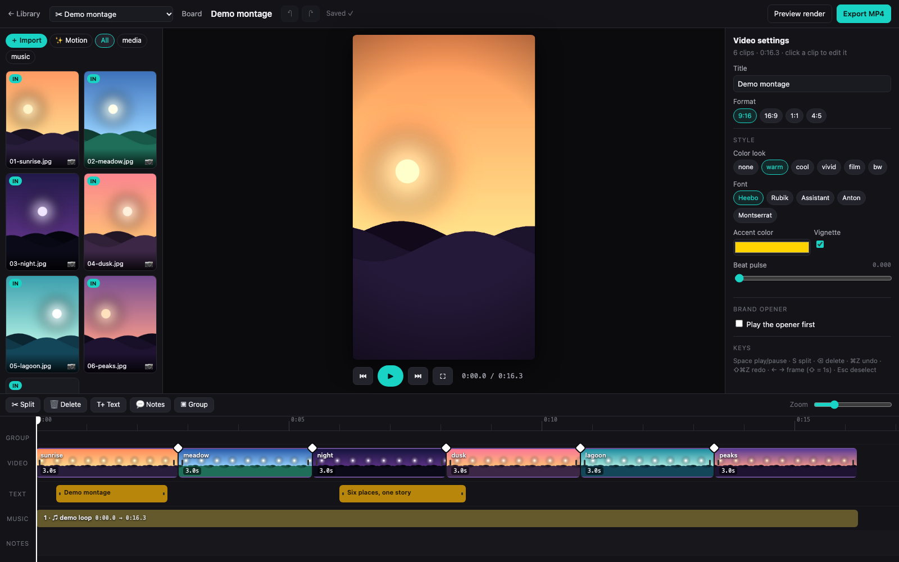
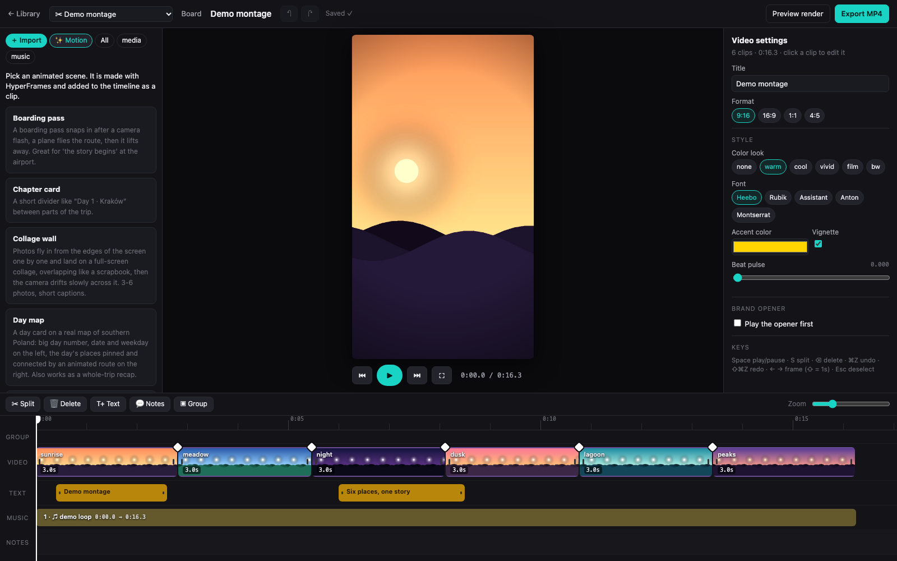
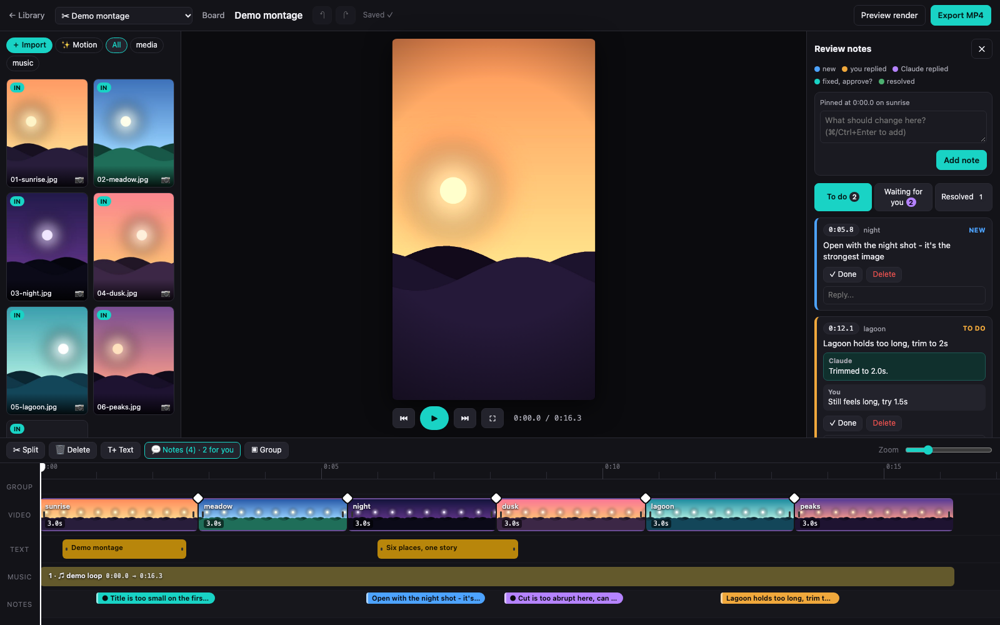
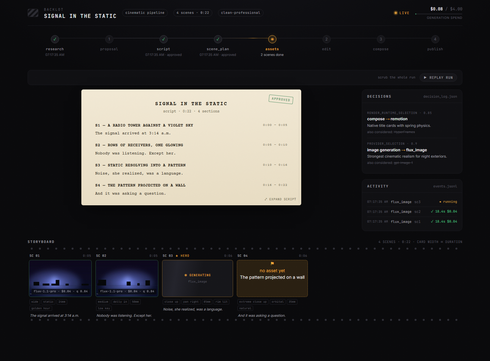

# AI Video Editor

Make videos by **talking to Claude Code** and finish them in a **CapCut-style browser editor**.
You describe the video, pick your photos/clips, Claude proposes the edit, you touch it up on a
timeline, and export an MP4.



## Install

**Requirements:** Python 3.10+, Node 20+, `ffmpeg`, and [Claude Code](https://claude.com/claude-code) (or Codex).

```bash
git clone https://github.com/<you>/ai-video-editor && cd ai-video-editor
python3 -m venv .venv && source .venv/bin/activate
pip install -r requirements.txt
(cd remotion-composer && npm install)       # HyperFrames runs via `npx hyperframes` (no global install)
python scripts/install_skills.py       # make all bundled skills visible to Claude Code
cp .env.example .env                  # add keys only for the providers you use
```

Try it with no photos of your own:

```bash
python scripts/make_demo_project.py   # synthetic demo project
python -m backlot serve --port 4750   # open http://127.0.0.1:4750/
```

`install_skills.py` links the skills that only ship for Codex into `.claude/skills/`; add `--user` to install them for all your projects.

Then open the folder in Claude Code and just ask, e.g. *"Make a 30-second montage from my
trip folder with upbeat music."* `CLAUDE.md` → `AGENT_GUIDE.md` tells the agent how to work.

## What you can do

**1. Bring your media in**
- Local folders, or the project's `source-media`
- **Google Photos** picker (`scripts/import_google_photos.py`; needs your own OAuth client in `.env`)
- **YouTube / online media** download for footage, audio and subtitles (`scripts/import_media_url.py`)

**2. Edit on a timeline** (`python -m backlot edit <project>`)
- Drag to reorder and trim, split, delete, undo/redo, zoom, groups and notes
- 23 transitions (fade, whip, iris, glitch, tunnel, light-leak…), Ken-Burns motion, speed, per-clip sound
- Color looks (warm, cool, vivid, film, bw), fonts incl. Hebrew/RTL, animated text styles
- Music with fade in/out, auto-ducking and beat pulse; formats 9:16, 16:9, 1:1, 4:5
- Live preview runs the same composition as the final render; autosave; you and Claude can edit the same timeline



**Review notes: code review for your film.** Press `C` (or 💬 Notes) to pin a comment to any moment on the
timeline. Claude works through them like PR comments: fixes the edit, replies, and marks them *fixed*;
you **Approve** or send them back. Notes are color-coded by state and follow their clip when you reorder.



**3. Add animated motion scenes** (HyperFrames, rendered into clips on your timeline)
Title / chapter / outro cards, photo collage, collage wall, snapshots, film strip, hanging photos,
photo stack, mosaic zoom, boarding pass, and animated route / day / pin maps. Edit the text and
re-render from the inspector.

**4. Let Claude produce videos end to end** with 13 pipelines: cinematic, documentary montage,
animated explainer, talking head, screen demo, podcast repurpose, clip factory, avatar spokesperson,
localization/dubbing, character animation and more. Providers are pluggable (image/video
generation, TTS, music, stock footage, captions, upscaling, analysis); see [docs/PROVIDERS.md](docs/PROVIDERS.md).

**5. Watch it happen: Backlot board** shows pipeline stages, script, storyboard, decisions and cost live.



**6. Export** the final MP4: `Export MP4` in the editor, or `python scripts/render_timeline.py <project>`.

## First video prompt

Once it's installed, paste this into Claude Code to get a tour video of the editor itself (uses the synthetic demo project, no personal media or API keys):

```text
Make a ~60-second landscape (16:9) video that explains how this editor works. Use only the synthetic demo project (python scripts/make_demo_project.py) so no personal media appears. Start the editor yourself (python -m backlot serve --port 4750) and capture real 1600x1000 screenshots at each step of the flow:
1. The library and "New montage"
2. Importing media: local folder, Google Photos, YouTube/online link
3. The media bin and the timeline: reorder, trim, split, zoom
4. Transitions, Ken-Burns motion, color looks, fonts, animated text, music with ducking
5. The Motion tab: a HyperFrames title card added as a clip
6. Review notes: pin a note, Claude fixes and replies, you approve, like a code review
7. Chatting with Claude Code to build the edit, and the Backlot board showing the pipeline live
8. Preview render and Export MP4

Build the video as a montage timeline in a new project: each screenshot is a clip with slow zoom or pan, a short caption (max 6 words) in the accent color, a different transition per cut, and a chapter card for each of the 8 steps. Add a title card first, an outro last ("Describe your video, finish it in the editor") and a calm instrumental music bed with fades. Zoom into the relevant area of the UI where it helps, with a highlight circle or arrow on the thing being explained.

Show me the plan and the shot list first and wait for my OK. Then render a draft preview, give me the frames to check, fix anything off, and export the final MP4. Tell me what you checked and where the file is.
```

## Layout

| Path | What |
|---|---|
| `backlot/` | Library, board and timeline editor (FastAPI + vanilla JS) |
| `remotion-composer/` | Reusable `FamilyMontage` Remotion composition |
| `motion_templates/` | HyperFrames motion scenes |
| `lib/`, `scripts/`, `tools/` | Timeline, imports, rendering, provider tools |
| `pipeline_defs/`, `skills/`, `.agents/`, `.claude/` | Pipelines and agent skills/commands |

More: [editor notes](docs/montage-editor.md) · [architecture](docs/ARCHITECTURE.md) · [backlot](backlot/README.md)

## Credits

Built on [OpenMontage](https://github.com/calesthio/OpenMontage). Licensed under AGPL-3.0 (see `LICENSE`).
